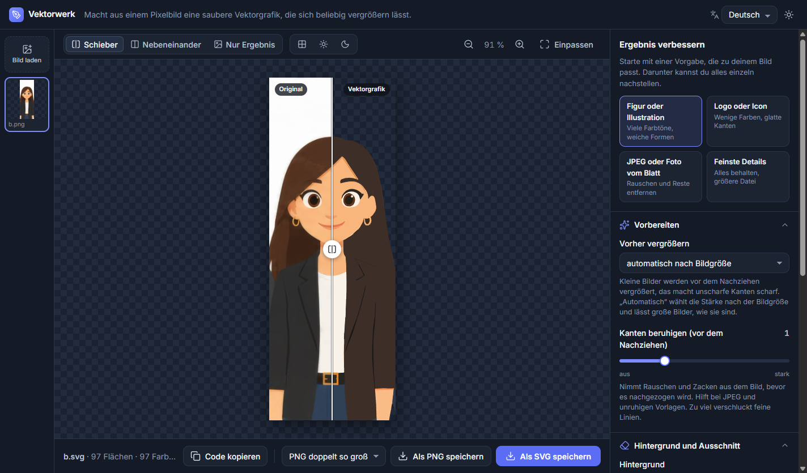

# Vektorwerk

Vektorwerk macht aus einem Pixelbild eine saubere Vektorgrafik, die sich beliebig vergrößern lässt. Ich habe es für gezeichnete Motive mit klaren Farbflächen gebaut: Figuren, Logos, Icons und Illustrationen. Für Fotos ist es nicht gedacht.

In diesem Repository liegen nur die Installer für Windows, kein Quellcode.

**Aktuelle Fassung:** [Releases](https://github.com/thecrafti87/Vektorwerk-releases/releases/latest)



## Was es kann

- JPEG, PNG oder WebP laden, auch mehrere auf einmal
- kleine Bilder vorher mit KI vergrößern, damit die Kanten scharf werden
- einfarbige Hintergründe jeder Farbe und sanfte Verläufe entfernen
- Original und Ergebnis mit einem Schieber vergleichen
- Kanten glätten, kleine Flecken entfernen, ähnliche Farben zusammenlegen
- als SVG oder PNG speichern
- Oberfläche auf Deutsch und Englisch, hell und dunkel

Alles läuft auf deinem Rechner. Es wird nichts hochgeladen.

## Was du brauchst

- Windows 10 oder 11
- **ffmpeg** muss installiert sein. Am einfachsten in der Eingabeaufforderung: `winget install ffmpeg`
- für das Vergrößern mit KI eine Grafikkarte mit Vulkan. Ohne sie vergrößert Vektorwerk einfacher.

## Installieren

Der Installer ist nicht signiert. Windows zeigt beim ersten Start deshalb einen Hinweis („Der Computer wurde durch Windows geschützt"). Über „Weitere Informationen" und „Trotzdem ausführen" geht es weiter.

Ab Version 0.3.2 aktualisiert sich Vektorwerk selbst: Gibt es eine neue Fassung, erscheint oben in der App ein Knopf. Ein Klick lädt sie, ein zweiter startet neu und installiert.

## Mit Claude verbinden (MCP)

Vektorwerk bringt eine Anbindung für Claude mit. Damit wandelt Claude Bilder selbst in Vektorgrafiken um und bessert sie nach, du gibst ihm nur die Bilddatei. Du musst dafür nichts zusätzlich herunterladen, auch Node nicht.

1. Vektorwerk installieren und öffnen.
2. Im Menü **Hilfe → Mit Claude verbinden …** wählen.
3. Für **Claude Code**: „Befehl für Claude Code kopieren", in ein Terminal einfügen, Enter. Für **Claude Desktop**: „Eintrag für Claude Desktop kopieren" und in die Datei `claude_desktop_config.json` einfügen (Einstellungen → Entwickler → Konfiguration bearbeiten).
4. Claude neu starten.

Der Befehl sieht so aus (der Pfad hängt von deinem Benutzernamen ab, deshalb am besten aus der App kopieren):

```
claude mcp add --scope user vektorwerk --env ELECTRON_RUN_AS_NODE=1 -- "C:\Users\<Name>\AppData\Local\Programs\Vektorwerk\Vektorwerk.exe" "C:\Users\<Name>\AppData\Local\Programs\Vektorwerk\resources\app\mcp.mjs"
```

Claude bekommt damit fünf Werkzeuge: `vektorisieren`, `verbessern`, `stapel`, `als_png` und `einstellungen_erklaeren`.

## Grenzen

- Gemusterte oder fotografische Hintergründe werden nicht entfernt.
- Das Ergebnis besteht aus Farbflächen. Einzelne Teile wie Haare oder Jacke sind nicht benannt.

## Fremde Bestandteile

Vektorwerk nutzt Real-ESRGAN, VTracer, resvg, Electron, die Schrift Inter und die Lucide-Icons. Lizenzen und Quellen stehen in [LIZENZEN-DRITTER.md](LIZENZEN-DRITTER.md).

BeZi-Film · Benjamin Ziemann
